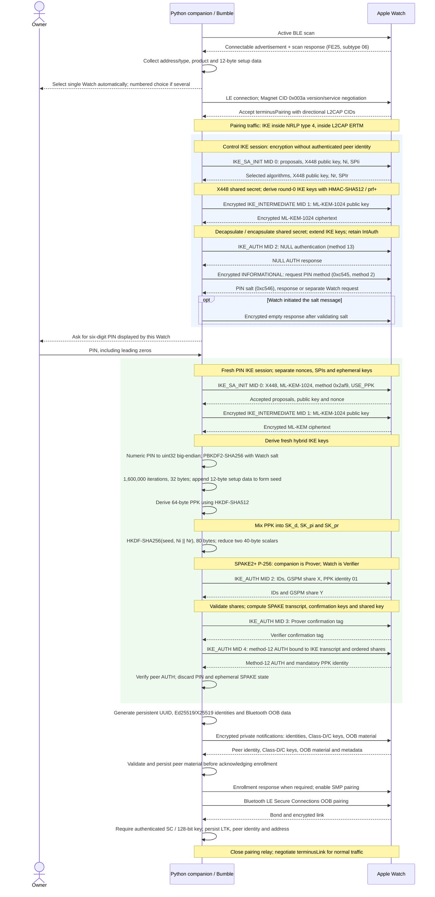
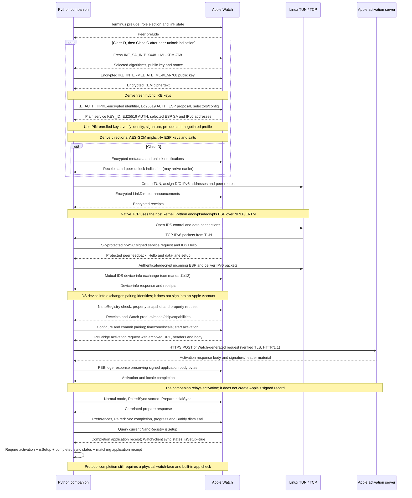

# Pairing and setup sequence

These charts describe the Python/Linux companion in `probe/`.
They use the author's observations of Apple Watch SE 3 with watchOS 26.4 and
public specifications. Pairing, bonding, activation and initial sync were
demonstrated on that device. The Watch became usable on its own.

The charts group some acknowledgements and fragments. They are not packet
captures. Other Watch models and watchOS versions are untested.
Read [LEGAL.md](../LEGAL.md) before using or extending the implementation.

## Discovery, PIN authentication and bonding

All encrypted IKE exchanges use AES-256-GCM with a 16-byte tag. SK/SKF carries
encrypted payloads; SKF handles fragmentation. HMAC-SHA512 is the IKE PRF.
NULL control authentication does not prove the Watch's identity; the PIN flow
must complete before trusting enrollment material or allowing SMP.

## Operational encryption, activation relay and initial sync

## Limits

App sync is partial. The companion announces the default app list over the
app-sync conduit. The Watch uses its own Wi-Fi to download apps.
Automatic installation is untested.

Activation requests use the host's Internet connection.
The companion does not provide a general Internet relay for the Watch.
Software updates and Apple Account sign-in are not implemented.
An Activation Lock ownership challenge is not successful activation.
